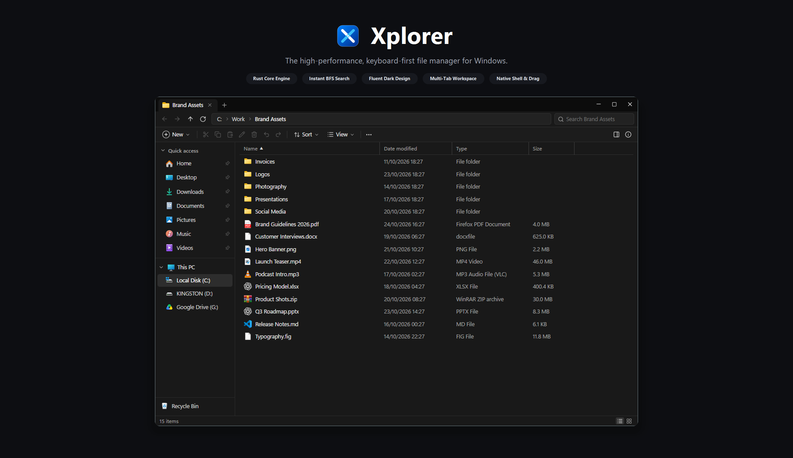

<div align="center">
  
</div>

# Xplorer

Windows 11 File Explorer has gotten slow. Between sluggish directory scanning, delayed searches, and cloud-first bloat, everyday file management can feel sluggish.

Xplorer is a fast, lightweight file manager designed specifically for Windows. It gives you the speed and keyboard responsiveness of a modern power-user tool without ditching essential Windows integrations like the real context menu and system drag-and-drop.

Under the hood, Xplorer is built on Tauri v2 and Rust for async disk I/O, coupled with a virtualized React frontend styled in a clean Fluent dark theme.

---

## Features

- **Instant BFS Search** - Searches run live as you type without blocking the UI. Matches in your current folder appear instantly (Level 0), followed by subfolders in breadth-first order with location badges.
- **Multi-Tab Workspace** - Open multiple tabs, duplicate them, and navigate history independently per tab using standard shortcuts (`Ctrl+T`, `Ctrl+W`, `Ctrl+Tab`).
- **Native Context Menus** - Unlike web-only file managers that display mock context menus, Xplorer bridges directly into Windows COM (`IContextMenu`) so you get your actual shell integrations: 7-Zip, WinRAR, VS Code, Open with, and Share.
- **True Drag and Drop** - Drag files directly into external applications (Discord, browsers, editors) or between tabs using native OLE drag support.
- **Fluent Dark Design** - Designed to feel right at home on Windows 11. Minimal chrome, smooth animations, and no unnecessary widgets.
- **Virtualized Views** - Switch between Details (List) and Grid views. Both use virtualized rendering to handle folders with tens of thousands of items without dropping frames.
- **Quick Preview Pane** - Inspect images, video, audio playback, and code or markdown files right in the sidebar without opening external programs.
- **Recycle Bin & Safe Operations** - Native shell deletion to the Windows Recycle Bin with one-click restore and full undo/redo (`Ctrl+Z` / `Ctrl+Y`) tracking.

---

## Downloads

Pre-built binaries are available on the [Releases](https://github.com/empfi/xplorer/releases) page for Windows 10 and 11 (64-bit):

| Package | Description |
| :--- | :--- |
| **Setup Wizard** (`.exe`) | Standard NSIS installer with desktop/start menu shortcuts and clean uninstallation. |
| **Standalone / Portable** (`.exe`) | Single portable executable with zero installation needed. Run it directly from anywhere. |

---

## Keyboard Shortcuts

| Shortcut | Action |
| :--- | :--- |
| `Ctrl + T` | Open new tab |
| `Ctrl + W` | Close current tab |
| `Ctrl + Tab` / `Ctrl + Shift + Tab` | Next / previous tab |
| `Ctrl + F` / `F3` | Focus search bar |
| `Alt + D` / `Ctrl + L` / `F4` | Focus address bar |
| `Alt + Left` / `Alt + Right` | Navigate back / forward |
| `Alt + Up` / `Backspace` | Navigate to parent directory |
| `Ctrl + Shift + N` | Create new folder |
| `F2` | Rename selected item |
| `F5` / `Ctrl + R` | Refresh directory |
| `Delete` | Move to Recycle Bin |
| `Shift + Delete` | Permanently delete |
| `Ctrl + Z` / `Ctrl + Y` | Undo / redo file action |
| `Ctrl + +` / `Ctrl + -` / `Ctrl + 0` | Adjust view scale |

---

## Building from Source

### Prerequisites

- [Node.js](https://nodejs.org/) (v18 or newer)
- [Rust toolchain](https://rustup.rs/) (stable channel, MSVC target)
- Visual Studio C++ Build Tools (included with Visual Studio or Build Tools installer)

### Setup

1. Clone the repository:
   ```bash
   git clone https://github.com/empfi/xplorer.git
   cd xplorer
   ```

2. Install frontend dependencies:
   ```bash
   npm install
   ```

3. Run in development mode (starts Vite with hot reload and attaches the Tauri window):
   ```bash
   npm run tauri dev
   ```

### Building Release Binaries

To produce the production installer and standalone binary:

```bash
npm run tauri build
```

The output artifacts will be placed under `src-tauri/target/release/bundle/`:
- **Installer**: `src-tauri/target/release/bundle/nsis/Xplorer_*_x64-setup.exe`
- **Standalone**: `src-tauri/target/release/xplorer.exe`

---

## Architecture

```
xplorer/
├── assets/                     # Visual assets & banner
├── src/                        # React frontend
│   ├── api.ts                  # Typed bridge calling Tauri IPC commands
│   ├── App.tsx                 # Core window layout, tab management & shortcuts
│   ├── types.ts                # TypeScript interfaces (FsEntry, Drive, Listing)
│   └── components/
│       ├── Sidebar.tsx         # Quick access navigation and drive list
│       ├── Topbar.tsx          # Path breadcrumbs, search bar, and view toggles
│       ├── FileView.tsx        # Virtualized list and grid views
│       ├── PreviewPane.tsx     # Syntax highlighting and media preview
│       ├── ContextMenu.tsx     # Context menu presentation
│       └── TransferDialog.tsx  # Background copy/move operations and conflict handling
└── src-tauri/                  # Rust backend
    ├── tauri.conf.json         # Tauri v2 window and bundle configuration
    └── src/
        ├── main.rs             # Tauri command setup & system tray
        └── commands/
            ├── fs_ops.rs       # Async BFS file search, directory reading, and disk ops
            ├── context_menu.rs # Windows COM IContextMenu integration
            ├── clipboard.rs    # Virtual clipboard and undo stack
            ├── system.rs       # Drive discovery, network devices, and shell execution
            └── recycle.rs      # Windows Recycle Bin COM interface
```

---

## License

This project is licensed under the [MIT License](LICENSE).
